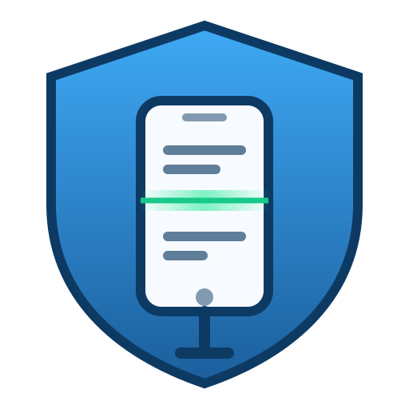

<p align="center">
  
</p>

<h1 align="center">mobsf-mcp</h1>

<p align="center">
  <a href="LICENSE"></a>
  
  
  
  
</p>

An MCP ([Model Context Protocol](https://modelcontextprotocol.io)) server for [MobSF](https://github.com/MobSF/Mobile-Security-Framework-MobSF): let any AI agent upload an Android or iOS app, run static and dynamic security analysis, and read the findings as normalized JSON or SARIF. Built on Spring AI 2.0, it serves **stdio** or **Streamable HTTP** from the same jar and image.

> **Not affiliated with the MobSF project.** This is an independent MCP wrapper that talks to
> MobSF over its REST API. MobSF runs as its own container under its own licence (GPL-3.0);
> report MobSF bugs to [the MobSF project](https://github.com/MobSF/Mobile-Security-Framework-MobSF/issues)
> and anything about this server here.

> Status: **1.0.0-beta.2 — beta.** Verified end to end against the official MobSF image:
> static analysis, JSON and SARIF reports, the app index, version comparison, suppression,
> retention, the hardened HTTP mode, and **dynamic analysis on a real Android emulator** —
> activity testing, screenshots, observed traffic, TLS tests and logcat.
>
> **Not yet verified: the Frida tools.** `frida_instrument`, `frida_api_monitor` and
> `frida_logs` are built against MobSF 4.5.4's API but have never run against live Frida
> output, because MobSF failed to install its frida-server on the emulator used here. The
> cause and the workaround are in
> [docs/dynamic-analysis-setup.md](docs/dynamic-analysis-setup.md). See
> [MILESTONES.md](MILESTONES.md) and [CHANGELOG.md](CHANGELOG.md).
>
> Only analyze apps you are authorized to test.

## Quick start: MobSF + MCP with docker compose
```bash
cp .env.example .env     # then set MOBSF_API_KEY and MCP_AUTH_TOKEN
docker compose up -d     # starts official MobSF (:8000) and mobsf-mcp (:8080)
cp ~/Downloads/app.apk ./apks/
bash scripts/smoke-test.sh app.apk
```
The MCP endpoint is `http://localhost:8080/mcp`, the MobSF UI is `http://localhost:8000` (mobsf/mobsf), apps go in `./apks`, and PDF reports come back in `./reports`.

Connect Claude Code:
```bash
claude mcp add --transport http mobsf http://localhost:8080/mcp --header "Authorization: Bearer $MCP_AUTH_TOKEN"
```

## Running the image directly
**Streamable HTTP** (the default):
```bash
docker run -d -p 127.0.0.1:8080:8080 -e MOBSF_URL=http://host.docker.internal:8000 -e MOBSF_API_KEY=<key> -e MCP_AUTH_TOKEN=<token> -v "$PWD/apks:/data/apks" -v "$PWD/reports:/data/reports" sure4docker/mobsf-mcp:latest
```
**stdio**, launched by the MCP client itself (Claude Desktop, Cursor, VS Code):
```json
{ "mcpServers": { "mobsf": {
  "command": "docker",
  "args": ["run","-i","--rm",
           "-e","MOBSF_URL=http://host.docker.internal:8000",
           "-e","MOBSF_API_KEY=<key>",
           "-v","C:/apks:/data/apks",
           "-v","C:/mobsf-reports:/data/reports",
           "sure4docker/mobsf-mcp:latest","--transport=stdio"] } } }
```
`--transport=stdio` and `MCP_TRANSPORT=stdio` do the same thing; the argument wins if both are set. Without either, the server runs over HTTP.

Without Docker: `./mvnw package -DskipTests` then `java -jar target/mobsf-mcp.jar [--transport=stdio]`.

## Configuration
| Env var | Default | Purpose |
|---|---|---|
| `MCP_TRANSPORT` | `http` | `stdio` or `http`; `--transport=` overrides it |
| `MOBSF_URL` | `http://localhost:8000` | Base URL of MobSF |
| `MOBSF_API_KEY` | none | MobSF REST API key (set the same value on both containers) |
| `MCP_AUTH_TOKEN` | none | **Required in http mode.** Clients send `Authorization: Bearer <token>` |
| `MCP_ALLOW_ANONYMOUS` | `false` | Allows http mode without a token; only on a private machine |
| `MCP_ALLOWED_ORIGINS` | empty | Browser origins allowed to call the server; requests with any other `Origin` are refused |
| `PORT` / `BIND_ADDRESS` | `8080` / `0.0.0.0` | HTTP listener |
| `UPLOAD_DIR` / `REPORT_DIR` | `/data/apks` / `/data/reports` | Mounted input and output directories |
| `MOBSF_MAX_UPLOAD_MB` | `500` | Size limit for URL downloads and HTTP uploads |
| `MOBSF_SCAN_TIMEOUT` | `20m` | How long a single MobSF scan call may take |
| `MOBSF_ANALYZER_IDENTIFIER` | none | Set on the **MobSF** container: the adb device for dynamic analysis, e.g. `host.docker.internal:5555` |
| `ALLOW_ADB_SHELL` | `false` | Enables the read-only `adb_command` tool |
| `MCP_SCAN_INDEX_CACHE_TTL` | `60s` | How long the app index is cached; it is refreshed automatically whenever this server uploads, scans or deletes |
| `MCP_SCAN_INDEX_MAX_SCANS` | `2000` | Cap on scans pulled from MobSF when building the app index |
| `MCP_RETENTION_ENABLED` | `true` | `false` makes `prune_scans` refuse instead of deleting |
| `MCP_RETENTION_KEEP_PER_APP` | `5` | Default scans kept per app when pruning |
| `MCP_RETENTION_MAX_AGE_DAYS` | `0` | Default age limit when pruning; `0` = no age limit |

> MobSF must run in its default **synchronous** mode. With `MOBSF_ASYNC_ANALYSIS=1` it queues scans and returns a task id instead of a report; `scan_app` detects that and tells you to turn it off rather than reporting a confusing missing report. The compose file pins it to `0`.

## Tools
| Tool | What it does |
|---|---|
| `mobsf_health` | Checks MobSF is reachable and the key is valid; on failure it says what to fix |
| `upload_app` | Uploads an app from a mounted `path`, an https `url`, or `base64` (≤10 MB) |
| `scan_app` | Runs static analysis and waits; returns `running` if the wait is too short |
| `scan_status` | Recent analysis steps and whether the scan finished |
| `get_scorecard` | Security score (0-100), finding counts, high severity titles, trackers |
| `get_report` | One report section: overview, permissions, manifest, code, network, secrets, trackers, certificate, files — or `all` |
| `download_pdf` | Writes MobSF's PDF report into the report directory |
| `list_scans` | Browse every scan MobSF holds, newest first |
| `find_app` / `search_scan` | Find an app by name, package or hash, with **every scanned version**; flags ambiguity when two apps share a name |
| `list_app_scans` | All scans of one app, newest first, optionally with each scan's security score |
| `get_normalized_report` | The whole scan as `mobsf-mcp-report/v1` JSON, optionally filtered by severity |
| `export_report` | Writes that JSON, MobSF's raw JSON, or **SARIF 2.1.0** into the report directory |
| `compare_scans` | Score difference and differing high severity findings between two scans, by hash |
| `compare_app_versions` | The same comparison by app and version, defaulting to the two most recent scans — "did this release get better or worse?" |
| `view_source` | Reads a source file behind a finding, so an agent can propose a fix rather than just report |
| `suppress_finding` / `unsuppress_finding` / `list_suppressions` | Dismiss a reviewed finding so it stops failing scans and CI gates; rule ids are checked against the scan first |
| `delete_scan` | Deletes one scan (marked destructive) |
| `prune_scans` | Reclaims MobSF disk by deleting old scans: **dry run by default**, never deletes an app's newest scan, and keeps exported reports |

### Dynamic analysis (needs an Android device or emulator — see [docs/dynamic-analysis-setup.md](docs/dynamic-analysis-setup.md))
| Tool | What it does |
|---|---|
| `device_status` | Whether MobSF has a device attached, its Android version, and what to set up if not |
| `mobsfy_device` | Prepares a device once: Frida server, MobSF CA, proxy |
| `start_dynamic` / `stop_dynamic` | Installs and launches the app, then collects logs, screenshots and app data |
| `test_activities` / `start_activity` | Exercises activities; `exportedOnly=true` targets access-control bugs |
| `run_tls_tests` | Cleartext traffic, certificate validation and pinning against the live app |
| `get_logcat` | Device log for one package, newest lines |
| `frida_instrument` | Built-in hooks (api_monitor, ssl_pinning_bypass, root_bypass…) and custom Frida scripts |
| `frida_api_monitor` / `frida_logs` / `list_frida_scripts` | Captured API calls, script output, and the built-in script list |
| `adb_command` | Read-only adb, only when started with `ALLOW_ADB_SHELL=true` |

Prompt: `full-apk-security-review` walks a client through the whole workflow.
Resources: `mobsf://report/{hash}/static` and `mobsf://report/{hash}/raw`.

## Reports for other tools
`export_report` and `get_normalized_report` return the **`mobsf-mcp-report/v1`** schema, published at [`schemas/mobsf-mcp-report.v1.json`](schemas/mobsf-mcp-report.v1.json). Static and dynamic findings share one shape, so a CI gate or issue-tracker import is written once:

```json
{ "schemaVersion": "mobsf-mcp-report/v1", "scanType": "static",
  "app": { "hash": "…", "packageName": "com.example.vuln" },
  "summary": { "securityScore": 30, "findingCounts": { "high": 4, "warning": 5 } },
  "findings": [{ "id": "static.code.android_insecure_random", "severity": "warning",
                 "category": "code", "evidence": [{ "file": "…/MainActivity.java", "line": "6" }],
                 "standards": { "cwe": "CWE-330: …", "masvs": "MSTG-CRYPTO-6", "cvss": 7.5 } }] }
```
Reports are written to `./reports/<hash>/static.json`, with `static.raw.json` for MobSF's own JSON and `static.sarif.json` for SARIF 2.1.0 (validated against the official SARIF schema). In http mode they can also be fetched with `GET /reports/<hash>/static.json`.

## Scanning in CI
This repository is also a GitHub Action: it starts MobSF, scans an app, and fails the build on high-severity findings.

```yaml
- uses: sethiraj/mobile-security-mcp@v1.0.0-beta.2
  id: mobsf
  with:
    app: app/build/outputs/apk/release/app-release.apk
    max-high: '0'          # -1 to report without failing the build
    min-score: '60'
- uses: github/codeql-action/upload-sarif@v3
  if: always()
  with:
    sarif_file: ${{ steps.mobsf.outputs.sarif }}
```
Findings then show up on the pull request as code-scanning alerts. If you are not on GitHub Actions, `scripts/ci-scan.sh` does the same thing with nothing but `curl`:
```bash
MAX_HIGH=0 MIN_SCORE=60 bash scripts/ci-scan.sh /data/apks/app-release.apk
```

## Documentation
- [docs/dynamic-analysis-setup.md](docs/dynamic-analysis-setup.md) — connecting a device or emulator
- [docs/RELEASING.md](docs/RELEASING.md) — publishing the image and listing the server
- [docs/decisions.md](docs/decisions.md) — what was verified against real MobSF, and why things are as they are
- [examples/spring-ai-agent](examples/spring-ai-agent) — driving the server from an agent, and from Python
- [SECURITY.md](SECURITY.md) — hardening and reporting issues

## Uploading from another machine (http mode)
```bash
curl -H "Authorization: Bearer $MCP_AUTH_TOKEN" -F "file=@app.apk" http://localhost:8080/uploads
# -> {"uploadId":"…"}; pass it to upload_app as uploadId
```

Agents should call `mobsf_health` first, then `get_scorecard` before `get_report`, because the full report is large.

## Development
```bash
./mvnw verify                        # 102 unit tests + MCP client and http-security tests
docker compose up -d --build         # real MobSF
bash scripts/smoke-test.sh app.apk   # upload -> scan -> scorecard through MCP
```
Validation results and design decisions are in [docs/decisions.md](docs/decisions.md).

## Credits
All the actual security analysis is **MobSF's** work. This project only exposes it over MCP.

- **[MobSF — Mobile Security Framework](https://github.com/MobSF/Mobile-Security-Framework-MobSF)**
  by Ajin Abraham ([@ajinabraham](https://github.com/ajinabraham)) and its contributors.
  Licensed GPL-3.0. Every score, rule and finding this server returns comes from MobSF; if you
  find this useful, star and support that project.
- **[Model Context Protocol](https://modelcontextprotocol.io)** and the MCP Java SDK, by Anthropic
  and the MCP community.
- **[Spring AI](https://github.com/spring-projects/spring-ai)**, which provides the MCP server
  and both transports.
- The insecure demo app under `docs/testapp/` is written for this repository; for realistic
  testing use published vulnerable apps such as
  [DIVA](https://github.com/payatu/diva-android) or
  [InsecureBankv2](https://github.com/dineshshetty/Android-InsecureBankv2).

## Author
**Surendran E** — [@sethiraj](https://github.com/sethiraj)

## License
MIT, see [LICENSE](LICENSE) — copyright (c) 2026 Surendran E.

MobSF is GPL-3.0 and runs as a separate service that this server talks to over HTTP; its code
is neither included nor linked here. See [NOTICE.md](NOTICE.md) for the full third-party
notices.
